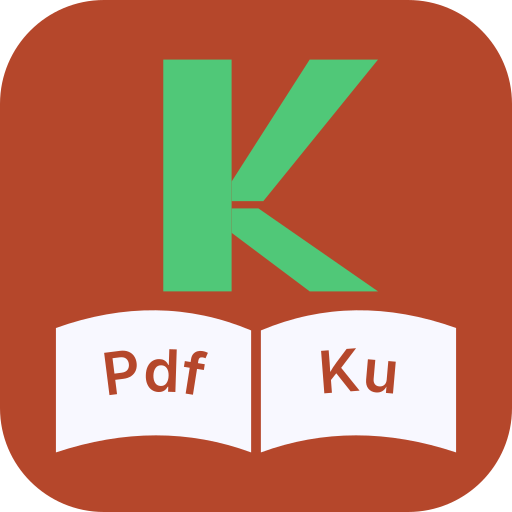

# PdfKu app icon



**Design:** a green letter K above an open book whose pages read "Pdf" and "Ku", on a brick-red
rounded tile. The project owner's original design.

**Palette:**

| Colour | Hex | Used for |
|---|---|---|
| Brick red | `#B5472B` | the tile and the lettering |
| Emerald | `#50C878` | the letter K |
| Ghost white | `#F8F8FF` | the book's pages |

**Tile:** `viewBox="0 0 512 512"`, a rounded square with `rx=104`. Windows and Linux icons use the
full-bleed tile. macOS icons put it on Apple's grid (an 824 px body centred on a transparent 1024 px
canvas).

**Lettering:** "Pdf" and "Ku" are outlines, not text: the glyphs of Inter SemiBold (OFL-1.1, already
in `assets/fonts/`) placed along each page's curve, so no font is needed to draw the icon and it looks
the same everywhere. Below about 48 px the lettering is too small to read; the K and the book carry
the icon at those sizes.

**File names:** the files keep their `pdfcraft` names and the `ai.storyteller.pdfcraft` id for now:
the build, the installers and the release workflow refer to them by those names.

Licence: [LICENSE.txt](LICENSE.txt) (`MIT OR Apache-2.0`, like the repo).

## Files

| File | What it is |
|---|---|
| `pdfcraft.svg` | the master vector; every PNG, `.ico` and `.icns` is rendered from it |
| `pdfcraft-small.svg` | a copy of the master, for the README |
| `pdfcraft-1024.png` | 1024 px on Apple's grid; also the runtime Dock icon on macOS |
| `pdfcraft.icns` | macOS icon (16–1024 px) |
| `pdfcraft.ico` | Windows icon (16–256 px), embedded in `pdfcraft.exe` by `apps/pdfcraft/build.rs` |
| `pdfcraft-document.svg` | Windows PDF file icon master: a Lucide document outline, red badge and outlined PDF lettering; no font dependency |
| `pdfcraft-document.ico` | Windows PDF file icon (16–256 px), embedded as resource 2 in `pdfcraft.exe` |
| `hicolor/<n>x<n>/apps/ai.storyteller.pdfcraft.png` | Linux hicolor theme, 16–512 px; the 256 px one is the runtime icon on Windows and Linux |
| `hicolor/scalable/apps/ai.storyteller.pdfcraft.svg` | Linux scalable icon (copy of the master) |

Where it shows: `apps/pdfcraft/src/main.rs` sets the window icon (Dock, taskbar, Alt-Tab, launcher) and the
Wayland app id `ai.storyteller.pdfcraft`; `packaging/linux/ai.storyteller.pdfcraft.desktop` names the
hicolor icon.

Windows PDF files use resource 2 (`"pdfcraft.exe",-2`) when PdfCraft is chosen as the default
reader; the app keeps resource 1. The document outline is adapted from Lucide `file-text`
1.49.0 (ISC); its badge and outlined lettering are original (`MIT OR Apache-2.0`), covered by
[LICENSE-document.txt](LICENSE-document.txt). Both icons are embedded, requiring no runtime
sidecar. This provides a file type icon; first-page thumbnails still need a thumbnail provider.

## Regenerate

```sh
packaging/icons.sh        # needs resvg and python3; iconutil (macOS) for the .icns
cargo xtask assets        # then update the sha256 values in ATTRIBUTION.toml and run with --write
```
